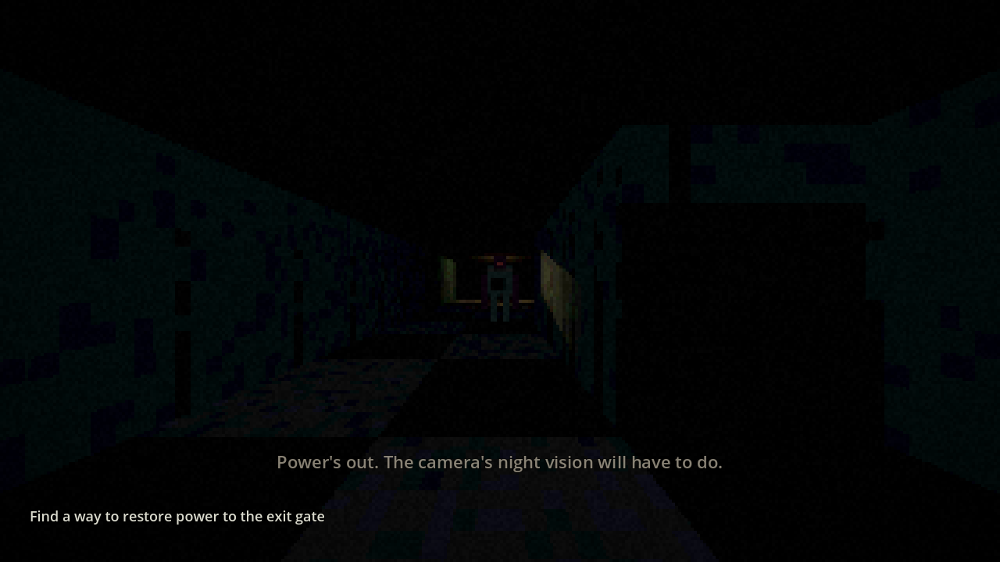
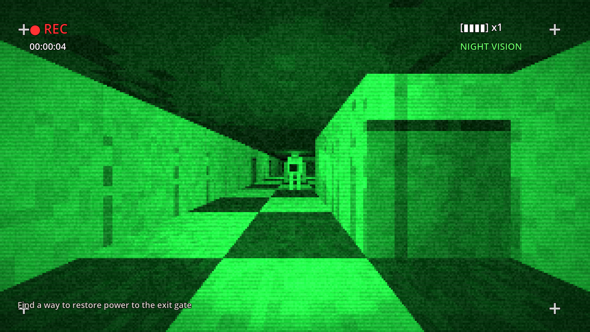

# WITNESS

First-person survival horror in Godot 4. You can't fight: run, hide, and see in the dark through
a camcorder's night vision. Inspired by the *design* of Outlast, with original story, characters and world.

| Normal view | Night vision |
|---|---|
|  |  |

## Play
1. Install [Godot 4.3+](https://godotengine.org/download) (standard build, free).
2. Open Godot → Import → select this folder's `project.godot` → press **F5**.

**Controls:** WASD move · Shift sprint (loud) · Ctrl/C crouch (silent) · Q/E lean · V look back ·
Right mouse camcorder · F night vision · R swap battery · Wheel zoom · Left mouse interact/hide ·
Space hold breath in a locker · Esc release mouse.

## Status: Level 1 playable prototype
- Level built from an editable ASCII map (`scripts/level/level_data.gd`)
- The Orderly: patrol → investigate → chase → search; hears footsteps, sees you in light,
  rips open lockers he saw you enter, listens for your breathing
- Camcorder: night vision, battery drain, zoom; PS1-style screen shader
- Scares: false alarm, patient reveal, scripted hunt; ambient sounds; dynamic music and heartbeat
- Objective: 2 fuses → fuse box → exit gate
- All audio is synthesised in code (placeholder until real recordings are added)

## Design docs
- [GAME_DESIGN.md](GAME_DESIGN.md): pillars, story, systems, milestones
- [docs/CHARACTERS.md](docs/CHARACTERS.md): protagonist, Eli, the 4 monsters
- [docs/LEVEL1_MAP.md](docs/LEVEL1_MAP.md): Level 1 map and pacing

## Tests
```
godot --headless res://tests/smoke_test.tscn
```
Drives the real game and checks AI, hiding, objectives and battery (13 checks).
